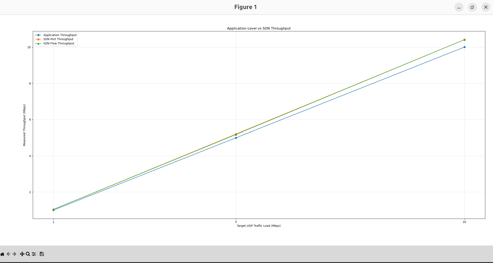

# SDN Bandwidth Meter and Traffic Analyzer

A UDP-based bandwidth measurement and traffic analysis application developed using Python, Mininet, Ryu SDN Controller, and OpenFlow 1.3.

## 1. Project Overview

This project measures UDP network throughput, packet transmission, packet reception, and packet loss at the application level. It also collects network-level port and flow statistics using a Ryu SDN controller.

The objective is to compare application-level bandwidth measurements with SDN statistics under different traffic loads.

## 2. Technologies Used

- Python 3
- Mininet
- Ryu SDN Controller
- OpenFlow 1.3
- Open vSwitch
- Ubuntu Linux
- Matplotlib

## 3. Network Architecture

The simulated network consists of two hosts connected through a single OpenFlow switch, which communicates with a remote Ryu controller.

```text
         Ryu SDN Controller
                 |
          OpenFlow 1.3
                 |
                s1
               /  \
             h1    h2
          Sender Receiver
```

Host h1 generates UDP traffic, while host h2 receives the packets. The Ryu controller manages packet forwarding and collects SDN statistics.

## 4. Project Files

| File | Description |
|---|---|
| `meter_complete.py` | Generates and receives UDP traffic and records application-level measurements |
| `flow_monitor_complete.py` | Implements the Ryu controller and collects SDN port and flow statistics |
| `compare_stats_complete.py` | Compares application-level and SDN measurements |
| `topology_complete.py` | Defines the custom Mininet topology |
| `bandwidth_comparison.png` | Graph comparing throughput under different traffic loads |

## 5. Execution Steps

### Start the Ryu Controller

From the project directory in Ubuntu, activate the environment containing Ryu and run:

```bash
source ryu310-env/bin/activate
ryu-manager --ofp-tcp-listen-port 6653 flow_monitor_complete.py
```

### Start Mininet

In another terminal:

```bash
sudo mn --topo single,2 --switch ovsk,protocols=OpenFlow13 --controller remote,ip=127.0.0.1,port=6653
```

### Verify Connectivity

Inside the Mininet CLI:

```bash
pingall
```

The connectivity test completed with 0% packet loss.

### Run UDP Experiments

Use `meter_complete.py` to generate and receive UDP traffic between the hosts.

The experiments used 1024-byte packets for approximately 10 seconds, with the following transmission rates:

| Target bandwidth | Packets per second |
|---|---:|
| 1 Mbps | 122 |
| 5 Mbps | 610 |
| 10 Mbps | 1221 |

Application-level results were saved to sender and receiver CSV files.

### Compare Application and SDN Measurements

For the 1 Mbps experiment:

```bash
python3 compare_stats_complete.py --send sender_test2.csv --recv receiver_test2.csv --sdn sdn_port_stats.csv --flows sdn_flow_stats.csv --dpid 1 --in-port 1 --out-port 2 --out comparison_test2.csv
```

Repeat using the corresponding Test 3 and Test 4 files for the 5 Mbps and 10 Mbps experiments.

## 6. Experimental Results

| Target bandwidth | Application throughput | SDN port throughput | SDN flow throughput | Packet loss |
|---|---:|---:|---:|---:|
| 1 Mbps | 0.999 Mbps | 1.040 Mbps | 1.040 Mbps | 0% |
| 5 Mbps | 4.997 Mbps | 5.202 Mbps | 5.180 Mbps | 0% |
| 10 Mbps | 10.002 Mbps | 10.413 Mbps | 10.413 Mbps | 0% |

### Bandwidth Comparison Graph



## 7. Observations

- Measured throughput increased with the generated UDP traffic load.
- Application-level throughput closely matched the target bandwidth.
- SDN measurements were slightly higher than application measurements, partly due to network protocol overhead.
- No packet loss was observed across the three experiments.
- The Ryu controller successfully collected network-level statistics for comparison.

## 8. Conclusion

The project successfully implemented a UDP bandwidth meter and traffic analyzer using Software-Defined Networking.

By comparing application-level measurements with SDN port and flow statistics, the experiments demonstrated consistent throughput measurements under different traffic loads.

The results highlight how SDN controllers can support network monitoring and traffic analysis using OpenFlow statistics.
